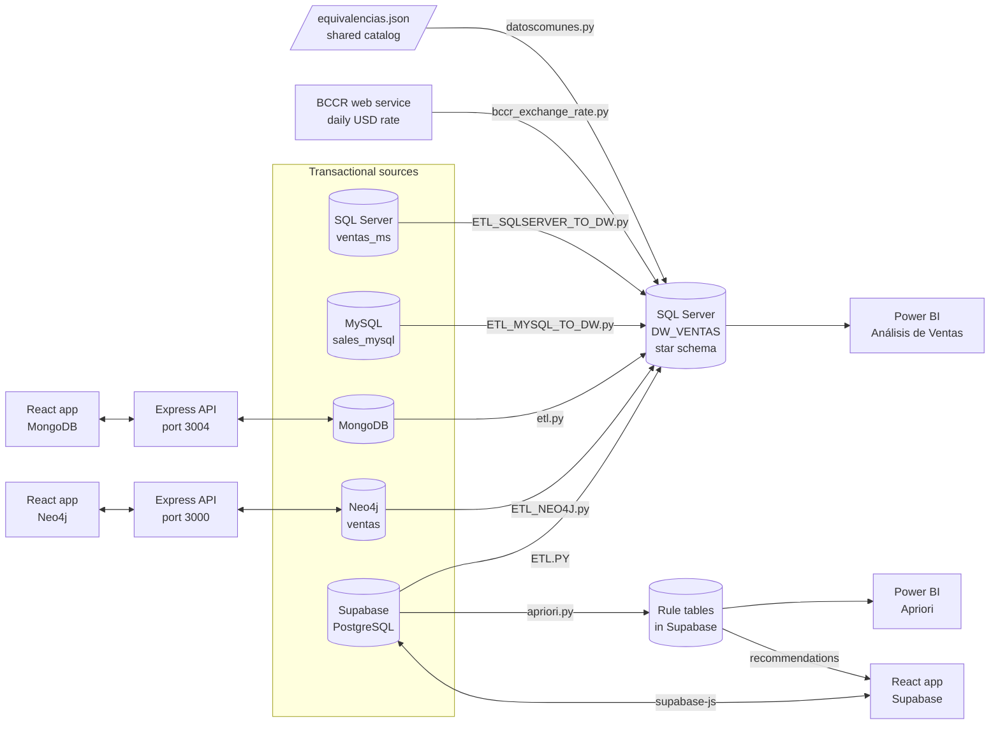
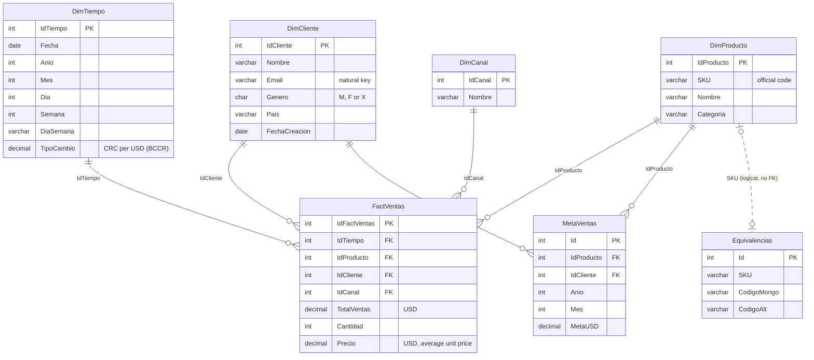

# Data_Enviroment

<p>
  <a href="LICENSE"></a>
  
  
  
  
  
  
  
  
  
  
  
  
  
  
  
</p>

End-to-end sales analytics platform that consolidates **five heterogeneous transactional databases** (SQL Server, MySQL, MongoDB, Neo4j and Supabase/PostgreSQL) into a **SQL Server star-schema data warehouse** through Python ETLs, then adds an **Apriori product-recommendation engine** and **Power BI dashboards** on top.

Built as a university final project at the Instituto Tecnológico de Costa Rica (2025) to practice the full data-engineering lifecycle: synthetic data generation, integration of inconsistent sources, dimensional modeling, incremental loading, association-rule mining and BI reporting.


---

## Table of Contents
- [Features](#features)
- [Authors](#authors)
- [Architecture](#architecture)
- [Technology Stack](#technology-stack)
- [Database Architecture](#database-architecture)
- [ETL Pipelines](#etl-pipelines)
- [Association Rules (Apriori)](#association-rules-apriori)
- [Power BI Dashboards](#power-bi-dashboards)
- [Project Structure](#project-structure)
- [How To Run](#how-to-run)
- [Testing](#testing)
- [What I Learned](#what-i-learned)
- [License](#license)

---

## Features
* **Five OLTP sources with deliberately inconsistent data.** Each one uses its own product code, currency, gender and channel values, and data types. For example, MySQL stores dates and amounts as text with mixed decimal separators.
* **Synthetic data generators** for every source (Python + Faker, Node.js, Cypher): 5,000 orders per source (420 by default for Supabase), all sharing a catalog of 180 products defined in [`equivalencias.json`](equivalencias.json).
* **Star-schema data warehouse (`DW_VENTAS`)** with `FactVentas`, four dimensions, a sales-target table (`MetaVentas`) and a cross-source product mapping table (`Equivalencias`).
* **Five Python ETLs** that standardize gender, channels and dates, convert colones (CRC) to dollars (USD) with the daily exchange rate, and map every product to one official SKU.
* **Incremental, re-runnable loads.** Three ETLs keep a log of the last date they loaded (MongoDB, Neo4j, Supabase); the other two check whether a row already exists before inserting (SQL Server, MySQL).
* **Exchange-rate job.** It downloads the daily USD buy rate from the Central Bank of Costa Rica (BCCR) SOAP web service into `DimTiempo`, and can register itself as a Windows Task Scheduler task or a cron job.
* **Apriori recommendation engine** (`mlxtend`) on Supabase orders. Rules are stored in normalized PostgreSQL tables, and old rules are flagged inactive (soft delete) instead of being deleted.
* **Live recommendations while building an order** in the Supabase React app ("customers who bought X also bought Y").
* **Three admin web apps** (React + Vite) with full create/read/update/delete (CRUD) and search for customers, products and orders on Supabase, MongoDB and Neo4j.
* **Two Power BI reports**: sales analysis and target tracking on the DW, plus an association-rules report.

---

## Authors
* **Isaac Villalobos** – [@IsaacVil](https://github.com/IsaacVil)
* **Natalia Orozco** – [@natiorozco](https://github.com/natiorozco)
* **Charlie Abarca** – [@CharlieAbarca](https://github.com/CharlieAbarca)
* **Dilan Hernandez** – [@DilanHern](https://github.com/DilanHern)

| Member | Main areas |
|---|---|
| Isaac Villalobos | Supabase/PostgreSQL source: seeding, ETL to the DW, Apriori pipeline and rule storage, React app with recommendations; loader for `Equivalencias`; documentation |
| Natalia Orozco | MongoDB source: Express + Mongoose API, seeding, ETL, React app; BCCR exchange-rate job |
| Charlie Abarca | SQL Server and MySQL sources and their ETLs; DW schema; sales targets; Power BI reports and CSV export |
| Dilan Hernandez | Neo4j source: graph model and Cypher seed, Express API, React app, ETL |

**My role:** I built the Supabase/PostgreSQL pipeline end to end:
* data seeding through the REST API, with injected purchase patterns;
* the incremental ETL into the DW (CRC→USD conversion, insert-or-update into `FactVentas`);
* the Apriori pipeline and its rule store, with soft-delete versioning;
* the React app that recommends products while an order is being built.

I also wrote the loader that fills the DW `Equivalencias` table, a DW reset script and the project documentation.

---

## Architecture
Batch-oriented, layered architecture. Each OLTP database is independent and has its own Python ETL that feeds a central SQL Server data warehouse. Power BI reads the warehouse, and the recommendation engine runs on the Supabase source.



**Data flow**
1. Each OLTP database is created and filled with synthetic sales, using the shared product catalog.
2. `datoscomunes.py` loads the catalog into the DW (`Equivalencias` + `DimProducto`), and the BCCR job fills `DimTiempo` with one row per day and its exchange rate.
3. Each ETL extracts its source, cleans and standardizes the data, converts amounts to USD and loads `FactVentas` at the warehouse grain.
4. `LlenadoMetaVentas.sql` derives monthly sales targets from historical sales.
5. Apriori mines the Supabase orders and stores the rules. The Supabase app uses them to suggest products, and Power BI reports on them.

**Key design decisions**
* **Grain:** one `FactVentas` row per *day × customer × product × channel*, with every amount in USD.
* **Surrogate keys** (`INT IDENTITY`) in every dimension. Source records are matched with **natural keys**: email for customers, SKU (through `Equivalencias`) for products, calendar date for time, and name for channels.
* **Cross-source mapping table:** `Equivalencias` links `SKU ↔ CodigoMongo ↔ CodigoAlt`, so a product sold in three databases under three different codes ends up as a single `DimProducto` row.
* **Currency conversion at load time**, using `DimTiempo.TipoCambio` (BCCR indicator 317, colones per dollar, buy rate).

**Web applications**

| App | Folder | Talks to | Port |
|---|---|---|---|
| Supabase admin + recommendations | `supabase/frontend` | Supabase directly via `@supabase/supabase-js` (anon key) | 3005 |
| MongoDB admin | `mongoDB/frontend` → `mongoDB/backend` | Express + Mongoose REST API (`/api/clientes`, `/api/productos`, `/api/ordenes`) | 3005 → 3004 |
| Neo4j admin | `neo4j/client` → `neo4j/server` | Express + neo4j-driver REST API (same routes plus `/api/categorias`, `/api/health`) | 3005 → 3000 |

---

## Technology Stack

### Backend Services
* **Node.js + Express 5**: REST APIs for MongoDB (Mongoose 8) and Neo4j (neo4j-driver 6)
* **Supabase / PostgREST**: auto-generated REST API over PostgreSQL, used by the seeding, ETL and Apriori scripts and by the React app
* **Python 3.10+**: ETLs, data generation and data science. Libraries: `pandas`, `mlxtend`, `pyodbc`, `SQLAlchemy`, `mysql-connector-python`, `pymongo`, `neo4j`, `requests`, `Faker`, `python-dotenv`, `supabase`

### Frontend
* React 18 + Vite 5, React Router 6, Axios, lucide-react, `@supabase/supabase-js`

### Database
* **SQL Server**: data warehouse `DW_VENTAS` and source `ventas_ms`
* **MySQL 8**: source `sales_mysql`
* **MongoDB**: document source (collections `clientes`, `productos`, `ordenes`)
* **Neo4j 5**: graph source `ventas`
* **Supabase (PostgreSQL)**: relational source plus Apriori rule tables

### BI
* Power BI Desktop (`Análisis de Ventas.pbix`, `Apriori.pbix`)

### Development & Deployment
* Local development on Windows. No containers or CI pipeline.
* PowerShell helper scripts (`install_deps.ps1`, `export_csv.ps1`), Windows Task Scheduler or cron for the exchange-rate job, Git/GitHub.

---

## Database Architecture

### Data warehouse `DW_VENTAS` (star schema)
DDL: [`dw/ScriptCreaciónDW.sql`](dw/ScriptCreaciónDW.sql)



**Sales targets** ([`dw/LlenadoMetaVentas.sql`](dw/LlenadoMetaVentas.sql)): for 2023–2025, the monthly target per customer–product pair is 80% of the average historical sales, multiplied by a deterministic factor between 0.90 and 1.09 so that attainment varies (roughly 80–120%). It is limited to the first 50 products and 50 customers to keep the volume manageable.

### Source databases and their deliberate differences

| Source | Product identifier | Currency | Gender values | Channels | Notable quirks | Seeded volume (customers · products · orders) |
|---|---|---|---|---|---|---|
| **SQL Server** `ventas_ms` (schema `sales_ms`) | `SKU` | USD | `Masculino`, `Femenino` | WEB, TIENDA, APP | Per-line discount (`DescuentoPct`) | 600 · 420 · 5,000 |
| **MySQL** `sales_mysql` | `codigo_alt` (no SKU) | USD / CRC | M, F, X | Free text | Dates and amounts stored as `VARCHAR`; 20% of prices use a decimal comma and 25% of totals use a thousands separator | 600 · 280 · 5,000 |
| **MongoDB** | `codigo_mongo`, plus an optional embedded `equivalencias {sku, codigo_alt}` | CRC (integers) | Masculino, Femenino, Otro | WEB, TIENDA | Line items embedded in the order document; coupon in `metadatos` | 600 · 250 · 5,000 |
| **Neo4j** `ventas` | `sku`, `codigo_alt` and `codigo_mongo` on the node | USD / CRC | Mixed (`M`, `Masculino`, `Otro`…) | Web, Tienda Física, Móvil, Teléfono, Marketplace | Line items are `CONTIENE {cantidad, precio_unit}` relationships | 800 · 127 · 5,000 |
| **Supabase** (PostgreSQL) | `sku` (can be null) | USD / CRC | M, F | WEB, APP, PARTNER | UUID keys, UTC timestamps, up to 35 products per order | 420 · 600 · 420 (default `ROWS=420`) |

DDL and seed scripts: [`sql server/ScriptCreación.sql`](sql%20server/ScriptCreación.sql), [`mysql/ScriptCreaciónMySQL.sql`](mysql/ScriptCreaciónMySQL.sql), [`mongoDB/backend/src/models/`](mongoDB/backend/src/models/), [`neo4j/llenado.cypher`](neo4j/llenado.cypher), [`supabase/backEnd/db/migrations/creationScript.sql`](supabase/backEnd/db/migrations/creationScript.sql).

**Neo4j graph model**

```text
(:Cliente)-[:REALIZO]->(:Orden)-[:CONTIENE {cantidad, precio_unit}]->(:Producto)-[:PERTENECE_A]->(:Categoria)
```
It has unique constraints on `Producto.sku`, `codigo_alt`, `codigo_mongo` and `id`, and on `Cliente.id` and `email`, plus an index on `Orden.fecha`.

**Apriori tables (Supabase)**
* `itemset (itemset_id, soporte, tamano)` and `itemset_item (itemset_id, producto_id)`: frequent itemsets
* `association_rule (rule_id, itemset_id, soporte, confianza, lift, active, deleted_at)`: rule metrics and soft-delete flag
* `rule_antecedente` and `rule_consecuente`: many-to-many link from each rule to the products on its left-hand and right-hand side

---

## ETL Pipelines
Every ETL follows the same pattern: **extract** the sales lines → **transform** (standardize gender to `M/F/X`, map the product code to a SKU through `Equivalencias`, find or create the channel and date, convert CRC → USD, aggregate to the warehouse grain) → **load** the dimensions and then `FactVentas`.

| ETL | Extraction | How it avoids duplicates | CRC → USD |
|---|---|---|---|
| [`sql server/ETL_SQLSERVER_TO_DW.py`](sql%20server/ETL_SQLSERVER_TO_DW.py) | `pyodbc`; aggregates in T-SQL by day / customer / product / channel and applies line discounts | Skips rows already in `FactVentas` for the same (email, SKU, date) | Not needed (USD only) |
| [`mysql/ETL_MYSQL_TO_DW.py`](mysql/ETL_MYSQL_TO_DW.py) | `mysql-connector`; casts text amounts in SQL | Same check, matching products by `CodigoAlt` | Uses `DimTiempo.TipoCambio` (see [known limitations](#known-limitations)) |
| [`mongoDB/backend/data/etl.py`](mongoDB/backend/data/etl.py) | `pymongo` aggregation (`$lookup` → `$unwind` → `$group`) | Log file `etl_execution.log` with the last order date loaded | Divides by `TipoCambio` (falls back to 500) |
| [`neo4j/ETL_NEO4J.py`](neo4j/ETL_NEO4J.py) | Cypher → staging files `nodes.jsonl` / `relationships.jsonl` | Log file `etl_ventas.log` with the newest node `fecha` loaded | Divides by `TipoCambio` |
| [`supabase/backEnd/db/ETL/ETL.PY`](supabase/backEnd/db/ETL/ETL.PY) | PostgREST, paginated in batches of 1,000 rows | Log file `logVentasIngreso.txt` with the last run time, plus insert-or-update into `FactVentas` (adds to existing totals) | Divides by `TipoCambio`; converts UTC to Costa Rica time (UTC-6) before picking the sales date |

**Product resolution when a source has no SKU**
* **MongoDB:** builds the SKU from `codigo_mongo` by reversing its digits (`MN-1189` → `SKU-9811`) and resolves collisions.
* **Supabase:** hashes name + category into `PRD-####-XX`.
* **MySQL:** uses `codigo_alt` as the SKU for products outside the shared catalog.

**Exchange-rate job** ([`dw/job/bccr_exchange_rate.py`](dw/job/bccr_exchange_rate.py)): `populate` loads the last 3 years in 180-day chunks, `update-current` stores the latest available rate, and `scheduler [HH:MM]` / `remove-scheduler` install or remove the daily job (default 05:00).

---

## Association Rules (Apriori)
Scripts: [`supabase/backEnd/db/apriori/`](supabase/backEnd/db/apriori/)

1. **Data preparation:** `orden_detalle` is turned into transactions (`orden_id` → set of `producto_id`) and then into a boolean one-hot basket (transaction × product) with pandas.
2. **Frequent itemsets:** `mlxtend.apriori` with `MIN_SUPPORT = 0.015`.
3. **Rules:** `association_rules` with metric `confidence` and `MIN_CONFIDENCE = 0.3`. Duplicate (antecedents, consequents) pairs are removed.
   * $support(X) = \frac{\text{transactions containing } X}{\text{total transactions}}$
   * $confidence(X \Rightarrow Y) = \frac{support(X \cup Y)}{support(X)}$
   * $lift(X \Rightarrow Y) = \frac{confidence(X \Rightarrow Y)}{support(Y)}$
4. **Persistence with versioning** (`insertapriori.py`):
   * Itemsets with the same product set are reused.
   * An identical active rule is skipped.
   * If an existing rule's metrics changed, the old version is soft-deleted (`active = false`, `deleted_at`) and the new one is inserted.
   * Rules that no longer appear in the latest run are soft-deleted.
5. **Review report:** `generarevision.py` writes the active rules to `reglas_revision.txt` in a readable form.
6. **Recommendations in the app:** when the set of products in the order being edited exactly matches a rule's antecedents, the rule's consequents are suggested. They are ranked by summed confidence, shown with their average lift, and can be added with one click (top 8).

> Random synthetic orders contain no real buying patterns. To give Apriori something meaningful to find, the Supabase seeding script injects 30 correlated patterns ({a, b} → c or {a, b, c} → d) into about 25% of orders. This is configurable through `CORRELATED_TRIPLETS` and `CORRELATION_PROB`.

---

## Power BI Dashboards

**`Análisis de Ventas.pbix`**: built on `DW_VENTAS`. Every page has slicers for year, customer, product, category and channel.

| Page | Content |
|---|---|
| Vista General | Total sales, average ticket, active customers, cumulative growth %, monthly sales vs previous year |
| Análisis de Ventas | Sales share by product category |
| Top Clientes y Productos | Customers and products ranked by sales |
| Ventas por canal | Sales by channel |
| Metas vs Ventas | Monthly sales vs `MetaVentas` targets and overall attainment % |
| Cumplimientos de Metas | Attainment % by customer and product |

**`Apriori.pbix`**: built on the Supabase sales and rule tables. *Vista General* shows a filterable table of antecedents → consequents with confidence, and *Productos más seguros* shows confidence by antecedent product. [`export_to_csv.py`](supabase/backEnd/db/csv/export_to_csv.py) exports those tables (plus flattened views) to CSV for Power BI.

| Metas vs Ventas | Top Clientes y Productos |
|---|---|
|  |  |

---

## Project Structure
```text
Data_Enviroment/
├── equivalencias.json          # Shared catalog: 180 products with SKU ↔ CodigoMongo ↔ CodigoAlt
├── Análisis de Ventas.pbix     # Power BI report on DW_VENTAS
├── Apriori.pbix                # Power BI report on association rules
├── install_deps.ps1            # Creates a venv and installs the Supabase seeding requirements
├── dw/
│   ├── ScriptCreaciónDW.sql    # DW_VENTAS star schema
│   ├── LlenadoMetaVentas.sql   # Monthly sales targets (MetaVentas)
│   ├── datoscomunes/           # Loads equivalencias.json into Equivalencias + DimProducto
│   ├── job/                    # BCCR exchange-rate job → DimTiempo
│   └── qualityoflife/          # Empties the DW and resets identity counters
├── sql server/                 # Source 1: DDL, Faker seeding, ETL → DW
├── mysql/                      # Source 2: DDL, "dirty data" seeding, ETL → DW
├── mongoDB/
│   ├── backend/                # Express + Mongoose API, data/seeding.js, data/etl.py
│   └── frontend/               # React admin app
├── neo4j/
│   ├── llenado.cypher          # Graph model, constraints and seed data
│   ├── ETL_NEO4J.py            # ETL → DW (JSONL staging)
│   ├── server/                 # Express + neo4j-driver API
│   └── client/                 # React admin app
└── supabase/
    ├── backEnd/db/
    │   ├── migrations/         # PostgreSQL DDL, including the Apriori tables
    │   ├── seeds/              # REST seeding with correlated purchase patterns
    │   ├── ETL/                # ETL → DW + incremental-load log
    │   ├── apriori/            # Apriori pipeline, rule persistence, review report
    │   └── csv/                # CSV export for Power BI
    └── frontend/               # React admin app with live recommendations
```

---

## How To Run

### Prerequisites
* **Windows 10/11 + PowerShell.** The scripts and defaults assume Windows. Most Python scripts pick ODBC Driver 17 on Windows and 18 on other systems.
* **Python 3.10+** and **Node.js 18+** with npm
* **SQL Server** (Express is enough), SSMS and the **Microsoft ODBC Driver for SQL Server**
* **MySQL 8**, **MongoDB** (local or Atlas), **Neo4j 5** (Neo4j Desktop; the ETL uses `elementId()`, which requires version 5)
* A **Supabase** project (the free tier works)
* **BCCR** economic-indicators web-service credentials (registered email + token)
* **Power BI Desktop**

Python dependencies for all modules, in one virtual environment at the repository root:
```powershell
python -m venv .venv
.\.venv\Scripts\Activate.ps1
pip install faker pyodbc python-dotenv requests mysql-connector-python pymongo neo4j sqlalchemy pandas mlxtend supabase
```

### Configuration
Each module reads its own configuration file. Copy the template next to it and fill in your values.

| Module | File the code reads | Template / keys |
|---|---|---|
| Equivalencias loader | `dw/datoscomunes/.env` | `dw/datoscomunes/env.txt` (`serverenv`, `databaseenv`, `usernameenv`, `passwordenv`) |
| BCCR job | `dw/job/.env` | `dw/job/env.txt` (adds `BCCR_USER`, `BCCR_PASSWORD`) |
| SQL Server ETL | `sql server/env.txt` (read directly) | `SOURCE_*`, `DW_*` |
| MySQL ETL | `mysql/env.txt` (read directly) | `MYSQL_*`, `DW_*` |
| MongoDB API, seed and ETL | `mongoDB/backend/.env` | `mongoDB/backend/env.txt` (`MONGODB_URI` + DW keys) |
| Neo4j ETL | `neo4j/.env` | `neo4j/.env.example` |
| Neo4j API | `neo4j/server/.env` | `neo4j/server/.env.example` |
| Supabase seed, ETL, Apriori | `supabase/backEnd/.env.local` | `supabase/backEnd/env.txt` (`SUPABASE_URL`, `SUPABASE_SERVICE_ROLE_KEY`, `MSSQL_*`) |
| Supabase CSV export | `supabase/backEnd/env.txt` (read directly) | Same keys |
| Supabase React app | `supabase/frontend/.env.local` | `VITE_SUPABASE_URL`, `VITE_SUPABASE_ANON_KEY` |

> `.env` and `.env.local` are git-ignored, but the `env.txt` files are tracked templates. The SQL Server, MySQL and CSV-export scripts read `env.txt` directly, so make sure you never commit real credentials in them.

### Quick start: full pipeline, in order
There is no single start script. Run the steps below from the repository root.

1. **Create the data warehouse:** run `dw/ScriptCreaciónDW.sql` in SSMS.
2. **Load the shared product catalog** into `Equivalencias` and `DimProducto`:
   ```powershell
   python dw/datoscomunes/datoscomunes.py
   ```
3. **Fill the time dimension with exchange rates** (last 3 years). Run this **before** the ETLs: they read `TipoCambio`, and the MongoDB and Supabase ETLs skip sales whose date is missing from `DimTiempo`.
   ```powershell
   cd dw/job
   python bccr_exchange_rate.py populate
   python bccr_exchange_rate.py scheduler 05:00   # optional daily job (run PowerShell as administrator)
   cd ../..
   ```
4. **Create and seed the sources** (each one is independent):
   ```powershell
   # SQL Server: run "sql server/ScriptCreación.sql" in SSMS, then
   cd "sql server"; python populate_db.py --server localhost --database ventas_ms --trusted; cd ..

   # MySQL: run mysql/ScriptCreaciónMySQL.sql, then
   cd mysql; python populate_mysql.py --host localhost --port 3306 --database sales_mysql --user root --password "<password>"; cd ..

   # MongoDB (deletes existing clientes/productos/ordenes first)
   cd mongoDB/backend; npm install; npm run seed; cd ../..

   # Neo4j: in Neo4j Browser run CREATE DATABASE ventas; then run neo4j/llenado.cypher against it
   #        (the script starts by deleting every node in the database)

   # Supabase: run supabase/backEnd/db/migrations/creationScript.sql in the SQL editor, then
   python supabase/backEnd/db/seeds/populate_db.py   # optional env vars: ROWS, CORRELATED_TRIPLETS, CORRELATION_PROB
   ```
5. **Run the ETLs into `DW_VENTAS`:**
   ```powershell
   python "sql server/ETL_SQLSERVER_TO_DW.py"
   python mysql/ETL_MYSQL_TO_DW.py
   python mongoDB/backend/data/etl.py
   cd neo4j; python ETL_NEO4J.py; cd ..          # writes its JSONL staging files and log in neo4j/
   python supabase/backEnd/db/ETL/ETL.PY
   ```
6. **Generate the sales targets:** run `dw/LlenadoMetaVentas.sql` in SSMS.
7. **Mine the association rules:**
   ```powershell
   python supabase/backEnd/db/apriori/apriori.py          # computes the rules and stores them in Supabase
   python supabase/backEnd/db/apriori/generarevision.py   # writes reglas_revision.txt
   ```
8. **Start the web apps** (see below).
9. **Open the Power BI reports:** open each `.pbix`, go to *Transform data → Data source settings*, point it to your SQL Server / Supabase instance and click *Refresh*. Optional CSV export:
   ```powershell
   cd supabase/backEnd/db/csv; python export_to_csv.py; cd ../../../..   # output in csv_exports/
   ```

### Start services individually
```powershell
# Supabase admin app (needs supabase/frontend/.env.local)
cd supabase/frontend
npm install
npm run dev                  # http://localhost:3005

# MongoDB API + admin app
cd mongoDB/backend
npm install
npm start                    # API on http://localhost:3004/api
cd ../frontend
npm install
npm run dev                  # http://localhost:3005

# Neo4j API + admin app
cd neo4j/server
npm install
node index.js                # API on http://localhost:3000/api
cd ../client
npm install
npm run dev                  # http://localhost:3005
```

### Notes
* **Ports:** MongoDB API `3004`, Neo4j API `3000`, and all three Vite apps `3005`. Run one front end at a time or use another port, e.g. `npm run dev -- --port 5173`.
* **Neo4j API start command:** in `neo4j/server/package.json`, `npm run dev` points nodemon at `../index.js`, which does not exist. Use `node index.js` or `npx nodemon index.js`. The API routes are hard-coded to the `ventas` database.
* **SQL Server authentication:** the Neo4j ETL only supports Windows authentication (`Trusted_Connection=yes`). The MongoDB and Supabase ETLs always use SQL authentication, so they need a user and password. The other scripts use SQL authentication when a user and password are set and Windows authentication otherwise.
* **Starting over:** `dw/qualityoflife/LimpiaTodoDelDWyRestauraIndices.sql` empties the DW and resets its identity counters, so the whole pipeline can be re-run.
* **`install_deps.ps1`** only installs `supabase/backEnd/db/seeds/requirements.txt` (`psycopg2-binary`, `Faker`). That does not cover everything the seeding script imports, so prefer the `pip install` command above.

### Known limitations
* The MySQL ETL **multiplies** CRC amounts by `TipoCambio` (colones per dollar) instead of dividing. It also stores `TipoCambio = 1.0` when it creates a new date. As a result, CRC orders from MySQL are not converted correctly.
* The MySQL ETL cleans prices with `REPLACE(precio_unit, ',', '')`, which turns decimal-comma prices such as `123,45` into `12345`. The `clean_number()` helper in the same file handles both formats but is not used in the query.
* The "other" gender is stored as `X` by most ETLs but as `N` by the MongoDB ETL.
* ETLs insert rows one at a time and commit every 50 rows. This is fine for about 5,000 orders per source but slow at larger volumes.

---

## Testing
There is no automated test suite: the `npm test` scripts are placeholders. The pipeline was validated by hand:

```sql
-- Row counts per DW table after loading
SELECT 'FactVentas' AS tabla, COUNT(*) AS filas FROM FactVentas
UNION ALL SELECT 'DimCliente',  COUNT(*) FROM DimCliente
UNION ALL SELECT 'DimProducto', COUNT(*) FROM DimProducto
UNION ALL SELECT 'DimTiempo',   COUNT(*) FROM DimTiempo
UNION ALL SELECT 'DimCanal',    COUNT(*) FROM DimCanal
UNION ALL SELECT 'MetaVentas',  COUNT(*) FROM MetaVentas;

-- Sales in USD by channel: channels from every source should appear
SELECT c.Nombre AS canal, SUM(f.TotalVentas) AS ventas_usd
FROM FactVentas f
JOIN DimCanal c ON c.IdCanal = f.IdCanal
GROUP BY c.Nombre
ORDER BY ventas_usd DESC;
```

* Each ETL prints the number of rows processed, skipped and failed.
* `GET http://localhost:3000/api/health` returns `{"status":"ok","neo4j":"connected"}` when the Neo4j API can reach the database.
* `reglas_revision.txt` lists the active association rules for manual review.

---

## What I Learned
* **Integrating sources that disagree.** Every database had its own product code, currency, channel names and gender encoding. A mapping table (`Equivalencias`) plus natural keys (email for customers, SKU for products) proved simpler and sturdier than matching records field by field.
* **Incremental, re-runnable loads.** A log of the last loaded timestamp, combined with insert-or-update into `FactVentas`, lets the Supabase ETL run again without duplicating sales. I also had to convert UTC timestamps to Costa Rica time before picking the day, so that each sale lands on the right `DimTiempo` row.
* **Apriori needs signal, and rules need history.** Uniformly random orders have no patterns to discover, so I seeded correlated product groups on purpose. Soft-deleting rules (`active`, `deleted_at`) keeps a history between runs while the app only uses the current ones.
* **What I would improve with more time:**
  * a shared ETL module instead of five copies of the same find-or-create logic;
  * bulk, set-based loads;
  * one configuration convention (`.env`) for every module;
  * Docker Compose for the five databases;
  * automated tests for the transformations.

---

## License
No license file has been added to this repository yet, so default copyright applies. Add a `LICENSE` file (for example MIT) to allow reuse.
